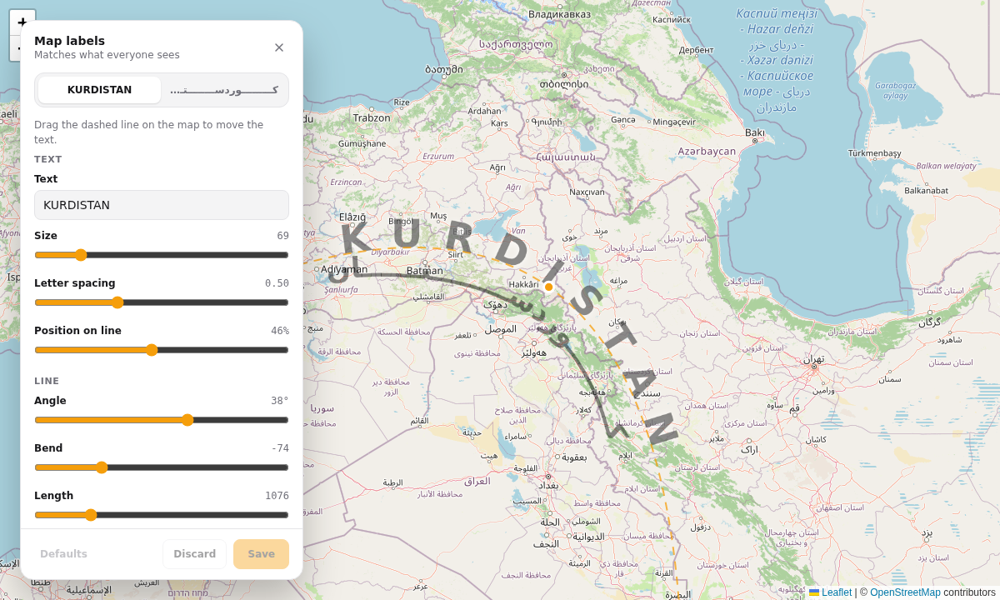
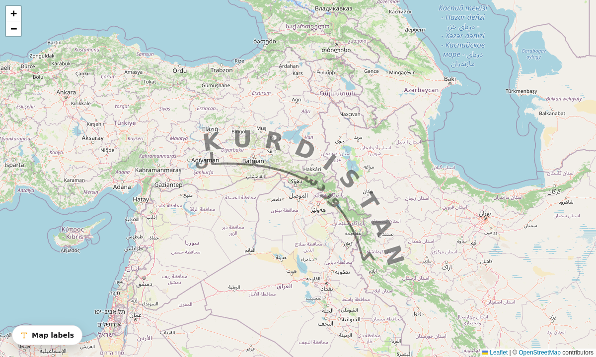
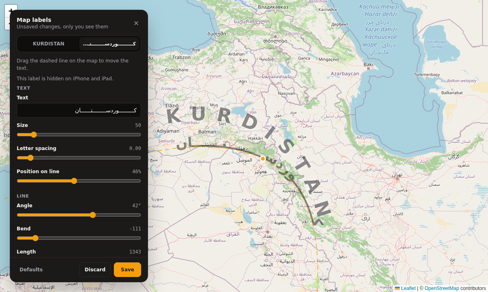
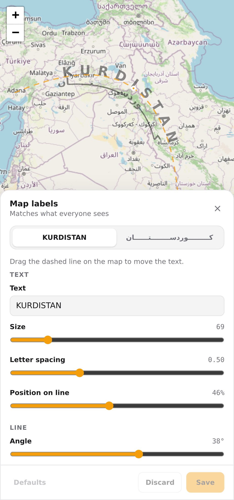

# react-leaflet-curved-labels

Large curved text labels for [react-leaflet](https://react-leaflet.js.org/) maps, for region names that follow a mountain range, a coastline or a border. It comes with an in-map **studio** where you drag a label into place and tune it with sliders. Edits stay a private draft until you save them.

- Text follows a curve and stays put while the map pans. Optionally it fades and shrinks as the user zooms in.
- Right-to-left scripts work, with a `kashida()` helper that stretches Arabic-script words along long curves.
- The studio has a launcher button, a panel that becomes a bottom sheet on phones, and a drag guide on the map. It can be themed and translated.
- You choose where labels are stored. Server-side helpers validate stored data, so a bad value can never break the map.
- Written in TypeScript, works with React 18 and 19 and react-leaflet 4 and 5, and is ready for the Next.js App Router.

**[Try the live demo](https://delgshseli.github.io/react-leaflet-curved-labels/)**. Your edits are saved only in your own browser.



| Labels only | Dark theme, mid-drag | On a phone |
| --- | --- | --- |
|  |  |  |

The screenshots come from the example app in [`examples/basic`](examples/basic). Map data © OpenStreetMap contributors.

## Install

```sh
npm install react-leaflet-curved-labels
```

Peer dependencies: `react`, `react-dom`, `leaflet` (1.9) and `react-leaflet` (4 or 5).

## Quick start

```tsx
import { MapContainer, TileLayer } from 'react-leaflet';
import 'leaflet/dist/leaflet.css';
import { EditableCurvedLabels, type CurvedLabel } from 'react-leaflet-curved-labels';
import 'react-leaflet-curved-labels/styles.css';

// The labels' 1000×500 coordinate box is stretched over this area of the map.
const BOUNDS: [[number, number], [number, number]] = [[47.5, 5.5], [43.5, 16.5]];

const LABELS: CurvedLabel[] = [
  {
    id: 'alps',
    text: 'THE ALPS',
    curve: { x1: 150, y1: 300, cx: 500, cy: 120, x2: 850, y2: 280 },
    fontSize: 60,
    letterSpacing: 0.4,
  },
];

export function Map() {
  return (
    <MapContainer center={[45.8, 10]} zoom={6} style={{ height: '100vh' }}>
      <TileLayer url="https://tile.openstreetmap.org/{z}/{x}/{y}.png" />
      <EditableCurvedLabels labels={LABELS} bounds={BOUNDS} fadeBetweenZooms={[7, 9]} />
    </MapContainer>
  );
}
```

With `editable` left off, this only draws the labels.

## Placing labels with the studio

Turn on `editable` for the people allowed to move labels, and pass `onSave`:

```tsx
const [labels, setLabels] = useState<CurvedLabel[]>(initialLabels);

<EditableCurvedLabels
  labels={labels}
  defaults={DEFAULT_LABELS}
  bounds={BOUNDS}
  editable={user.isAdmin}
  onSave={async (next) => {
    const res = await fetch('/api/map-labels', {
      method: 'POST',
      headers: { 'Content-Type': 'application/json' },
      body: JSON.stringify(serializeLabels(next)),
    });
    if (!res.ok) throw new Error('Save failed'); // the studio shows an error and keeps the draft
    setLabels(next);
  }}
/>
```

A **Map labels** button appears in the corner. In the studio you can:

- choose a label (tabs appear when there is more than one);
- drag the dashed line or its dot on the map to move the label;
- change its text, size, letter spacing and position along the line;
- change the line's angle, bend and length. The label turns, bows and stretches in place.
- use **Save** to call `onSave`. **Discard** goes back to the saved version, and **Defaults** goes back to `defaults`.

Only the person editing sees the draft. Everyone else sees `labels` until you save and pass the new labels back in.

> `editable` only hides the studio. It is not access control. Always check permissions on the server before you store anything.

### Loading and saving on the server

`react-leaflet-curved-labels/server` has framework-free helpers with no React or Leaflet imports. `applyStoredLabels` applies stored edits to *your* default labels, matched by id. Unknown ids are ignored. Only the editable fields (text, curve, size, spacing, position) can change, and they are clamped to safe ranges. Styling such as colours and fonts always comes from your code.

```ts
// app/api/map-labels/route.ts (Next.js)
import { applyStoredLabels, serializeLabels } from 'react-leaflet-curved-labels/server';
import { DEFAULT_LABELS } from '@/map/labels';

export async function GET() {
  const stored = await db.get('map_labels'); // whatever you stored, or null
  return Response.json(applyStoredLabels(DEFAULT_LABELS, stored));
}

export async function POST(req: Request) {
  if (!(await isAdmin(req))) return new Response('Forbidden', { status: 403 });
  const labels = applyStoredLabels(DEFAULT_LABELS, await req.json());
  await db.set('map_labels', serializeLabels(labels));
  return Response.json(labels);
}
```

To stop labels jumping, draw them only once the saved version has loaded. Don't draw the defaults first and swap them afterwards:

```tsx
{labels && <EditableCurvedLabels labels={labels} bounds={BOUNDS} />}
```

## Coordinates

All labels share one SVG overlay. Its `viewBox` (default `0 0 1000 500`) is stretched over `bounds`: x runs from the west edge (0) to the east edge (1000), and y from the north edge (0) to the south edge (500). Points may lie outside the box, which is normal for long, gentle arcs. You rarely need to type coordinates. Start with something rough, such as `curveAround({ x: 500, y: 250 })`, then place it in the studio and save.

Each curve is a quadratic Bézier from `(x1, y1)` through the control point `(cx, cy)` to `(x2, y2)`. The text is centred at `startOffset` percent of the way along it.

## Right-to-left text

```tsx
import { kashida } from 'react-leaflet-curved-labels';

const label: CurvedLabel = {
  id: 'kurdish',
  text: kashida(['ک', 'وردس', 'ت', 'ان'], [9, 8, 6]), // کـــــــــوردســـــــتــــــان
  direction: 'rtl',
  lang: 'ckb',
  curve: { x1: -381, y1: 316, cx: 1130, cy: -325, x2: 616, y2: 1216 },
  fontSize: 50,
  hideOnAppleTouch: true,
};
```

- Only add kashida between letters that join.
- WebKit (Safari on iPhone and iPad) can lay right-to-left text out in the wrong order along a curved path. `hideOnAppleTouch` skips that label on those devices. iPhone and iPad are detected before the first paint, so the label never flashes.
- Test right-to-left labels in Chrome, Firefox and Safari. `side` (SVG 2) changes the result in Firefox only.

## API

### `<EditableCurvedLabels>`

Takes every `<CurvedLabels>` prop, plus:

| Prop | Type | Default | |
| --- | --- | --- | --- |
| `editable` | `boolean` | `false` | Show the studio |
| `onSave` | `(labels) => void \| Promise<void>` | | Throw or reject to show an error |
| `defaults` | `CurvedLabel[]` | | Enables the **Defaults** button |
| `fields` | `EditableField[]` | all | Limit the controls: `'text' \| 'fontSize' \| 'letterSpacing' \| 'startOffset' \| 'curve'` |
| `messages` | `Partial<StudioMessages>` | English | Translate or reword the UI |
| `theme` | `'light' \| 'dark' \| 'auto'` | `'auto'` | Studio colours |
| `position` | `'bottom-left' \| 'bottom-right'` | `'bottom-left'` | Studio placement on wide screens |
| `guideColor` | `string` | `#f59e0b` | Drag guide colour |
| `guideZIndex` | `number` | `640` | Raise this if another layer covers the guide |
| `onEditingChange` | `(editing) => void` | | For example, to pause popups while editing |

### `<CurvedLabels>`

| Prop | Type | Default | |
| --- | --- | --- | --- |
| `labels` | `CurvedLabel[]` | | |
| `bounds` | `LatLngBoundsExpression` | | The area the viewBox covers |
| `viewBox` | `string` | `'0 0 1000 500'` | |
| `fadeBetweenZooms` | `[from, to]` | | Fully visible at `from`, gone at `to` |
| `pane` | `string` | overlay pane | |
| `fadeIn` | `boolean` | `true` | Fade in when first drawn |

### `CurvedLabel`

| Field | Type | |
| --- | --- | --- |
| `id` | `string` | Unique and stable |
| `text` | `string` | |
| `curve` | `LabelCurve` | `{ x1, y1, cx, cy, x2, y2 }` |
| `fontSize` | `number` | viewBox units |
| `letterSpacing?` | `number` | em, default 0 |
| `startOffset?` | `number` | 0–100, default 50 |
| `fontFamily?`, `fontWeight?`, `fill?` | | Default system-ui, 700, translucent grey |
| `style?`, `className?` | | For the SVG `<text>`, for example `textShadow` |
| `direction?`, `lang?`, `side?` | | Right-to-left and shaping |
| `hideOnAppleTouch?` | `boolean` | |

### Building blocks

Use these to build your own UI.

- `<CurvedLabelGuide>`: the drag guide, in its own pane above canvas layers.
- `<CurvedLabelStudio>`: the panel. It is controlled: you pass `saved`, `draft`, `selectedId` and the handlers.
- Geometry helpers: `curvePath`, `parseCurvePath`, `moveCurve`, `curveAngle`/`withCurveAngle`, `curveBend`/`withCurveBend`, `curveLength`/`withCurveLength`, `curveMidpoint`, `pointAlongCurve`, `curveAround`.
- Label helpers: `applyStoredLabels`, `normalizeLabel`, `serializeLabels`, `sameLabels`, `kashida`, `isAppleTouchDevice`.

## Styling

The studio uses plain CSS classes prefixed `clp-` and these custom properties:

```css
.clp-panel,
.clp-launcher {
  --clp-accent: #2563eb;
  --clp-on-accent: #fff;
  --clp-radius: 12px;
  --clp-font: 'Inter', sans-serif;
  --clp-z: 2000;
  /* also: --clp-bg, --clp-surface, --clp-fg, --clp-muted, --clp-border, --clp-danger */
}
```

The panel renders into `document.body`, so clicks and scrolls on it never reach the map.

## Notes

- Leaflet's stylesheet turns off pointer events on SVG paths inside its panes. The guide works around this with inline styles and its own pane (z-index 640, above markers and canvas renderers).
- On phones the panel is a bottom sheet. Long text in a tab is truncated, and the full text is shown on hover.
- Respects `prefers-reduced-motion`.

## Development

```sh
npm install
npm test          # node:test, no browser needed
npm run typecheck
npm run build
npm run example   # Vite demo at http://localhost:5173 that saves to localStorage
```

## License

[MIT](LICENSE)
